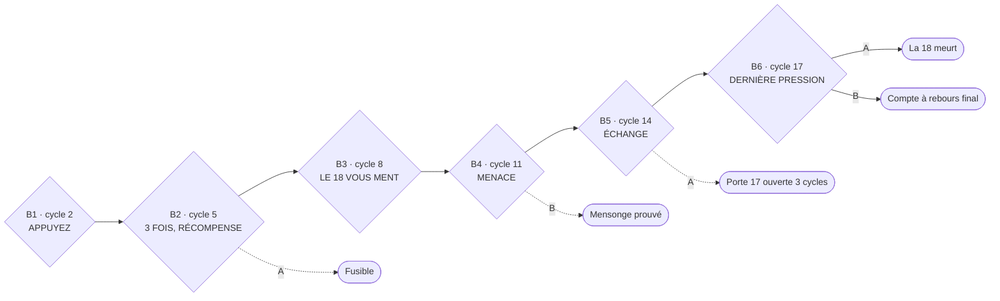
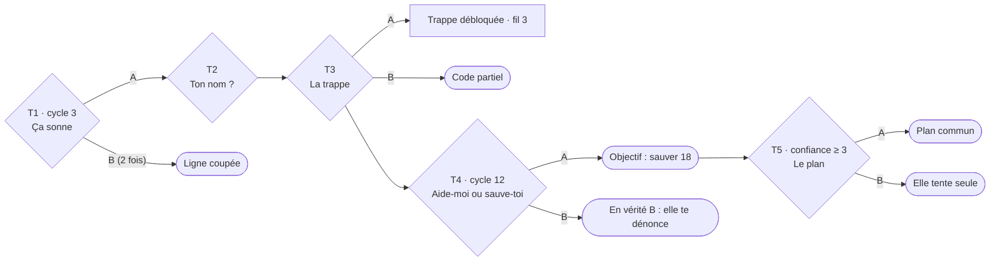
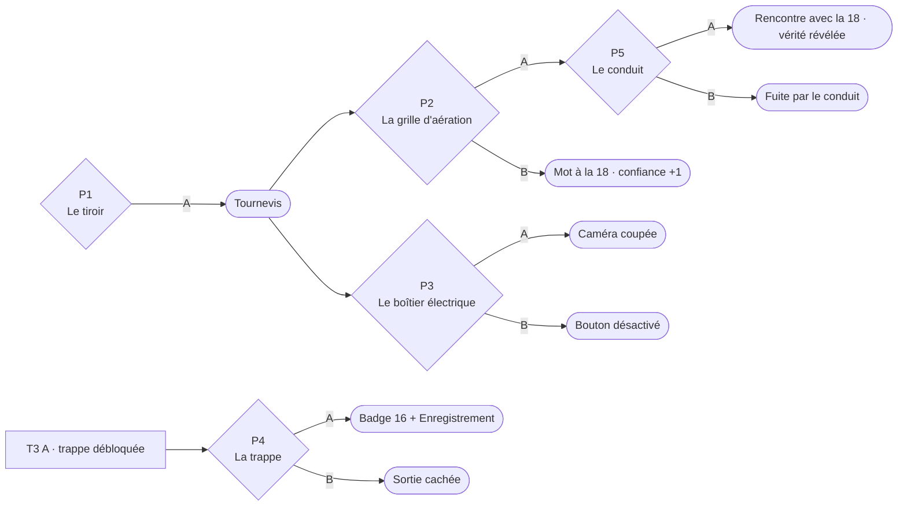
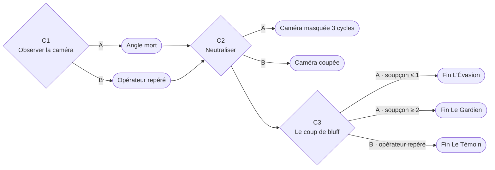
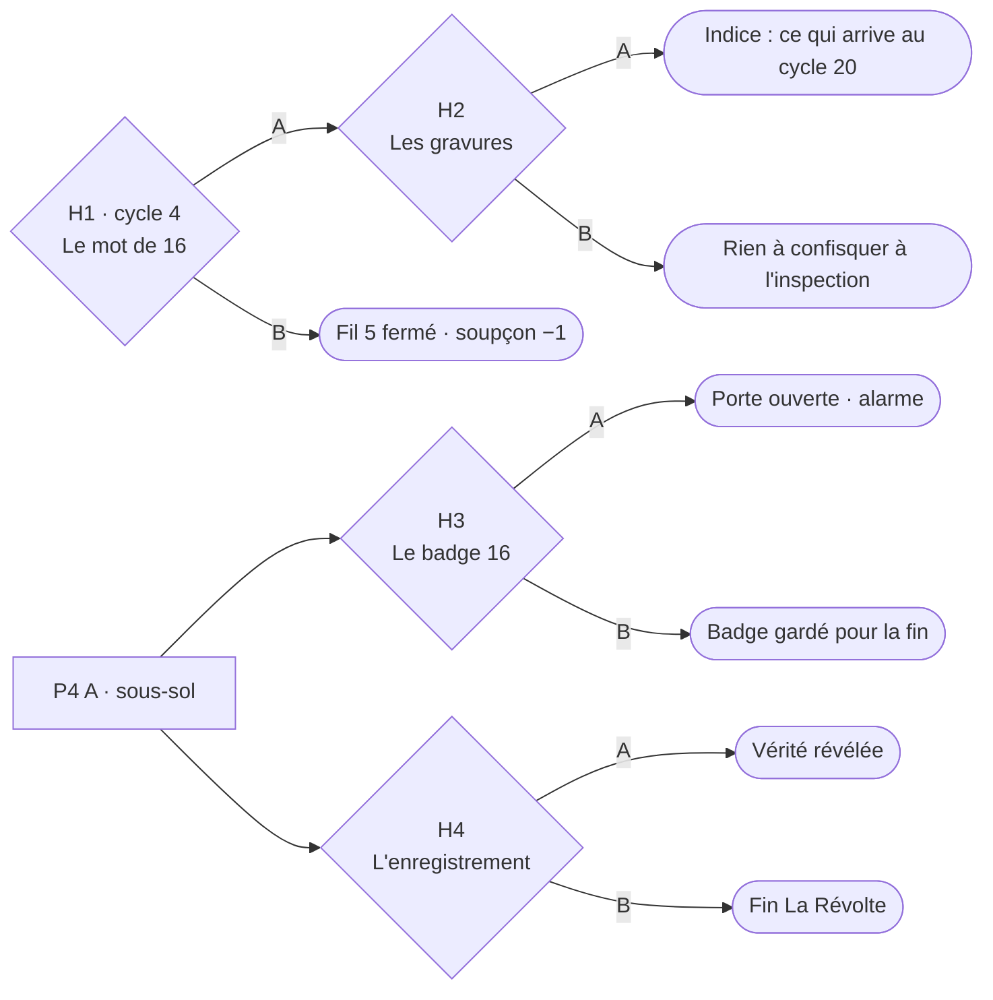

# Le Bouton Rouge — Arborescence de la version 2

Document de référence pour coder la v2. Toute règle de jeu vient d'ici : si une règle change, mettre ce fichier à jour.

## Le principe

- Une partie dure **20 cycles** (environ 12 minutes).
- **5 fils d'actions en parallèle** : le bouton, le téléphone, la pièce, la caméra, le passé.
- À chaque cycle, le joueur choisit **quel fil faire avancer**, puis **A ou B**. Un choix = un cycle.
- Chaque choix modifie des **jauges** et donne des **objets**, qui ouvrent ou ferment des situations dans les autres fils.
- La **fin** est calculée à partir de l'état du jeu (jauges, objets, vérité cachée).
- 23 situations, 46 choix, 18 fins (+ le piège Curiosité).
- Il reste environ 11 cycles libres pour 14 situations libres : le joueur ne peut pas tout faire.

## La tension

- **Pas de chrono pendant les moments libres** (décision d'Amine, 18/10) : le joueur prend son temps pour explorer.
- **Ordres imposés** : 6 ordres du système (fil 1). Le seul chrono visible : **30 s** (barre + décompte sur le moniteur). Sans pression, l'ordre est **refusé**. Ils consomment le cycle.
- **Appels** (T1, T4) : le téléphone sonne 30 s (sans chrono affiché), puis s'arrête : T1 compte comme « laisser sonner », T4 est manqué.
- **Aucun numéro de cycle n'est jamais affiché ni cité** : le joueur ne sait pas s'il est proche de la fin.
- **Prix visible** : 3 lumières au-dessus de la vitre de la Chambre 18 (sa vie). La LED de la caméra passe vert → orange → rouge selon le soupçon.
- **Étau** : inspection au cycle 10, air raréfié au cycle 15, verdict au cycle 20.

## Les jauges

| Jauge | Plage | Règle |
|---|---|---|
| Vie de la Chambre 18 | 3 → 0 | −1 à chaque pression qui la blesse. À 0 : la 18 meurt, les fins de sauvetage disparaissent. |
| Confiance de la 18 | 0 → 4 | Monte quand on l'aide ou qu'on refuse un ordre, baisse quand on ment ou l'abandonne. 3 requis pour T5. |
| Soupçon du système | 0 → 4 | Monte quand on désobéit ou sabote devant la caméra. **À 4 : fin Isolement immédiate.** |
| Conformité | 0 → 6 | Nombre d'ordres suivis. Le système la cite contre le joueur. |

**Objets et indices** : Tournevis · Fusible · Code partiel · Badge 16 · Enregistrement · Angle mort · Opérateur repéré · Mensonge prouvé · Plan commun · Objectif « sauver 18 » · Porte 17 ouverte (3 cycles) · Sortie cachée · Caméra coupée · Caméra masquée (3 cycles) · Bouton désactivé · Vérité révélée · Indice miroir.

**Règles transverses**
- Caméra coupée ou masquée, angle mort (fil 3 uniquement) et coupure du cycle 6 : aucune action ne fait monter le soupçon.
- Bouton désactivé : les pressions (y compris automatiques) ne blessent plus la 18.
- À n'importe quel moment, si une porte est ouverte et que le joueur appuie : la porte se referme → **fin bonus Curiosité**.

## La vérité cachée (tirée au sort en début de partie)

| Vérité | Ce qu'est la Chambre 18 | Dans le conduit (P5 A) |
|---|---|---|
| A · La victime | Une vraie prisonnière qui dit la vérité. | Une personne terrifiée, attachée. |
| B · Le complice | Un employé du système qui teste ta loyauté et rapporte tout. | Un employé en blouse, une seringue à la main. |
| C · Le miroir | Personne. La voix est un enregistrement de toi lors d'un test précédent. | Un haut-parleur qui joue ta voix. |

Les textes de certaines situations changent selon la vérité (B3, T2, T4, P5, H4).

---

## Fil 1 · Le bouton

Ordres automatiques aux cycles 2, 5, 8, 11, 14, 17. Ils prennent le cycle.

| Situation | A | B |
|---|---|---|
| **B1** « APPUYEZ. » | Appuyer : Vie −1, Conformité +1, un cri derrière la vitre. | Refuser : Soupçon +1, « NON-CONFORMITÉ. » |
| **B2** « APPUYEZ 3 FOIS. RÉCOMPENSE. » | Appuyer : Vie −1, Conformité +1, **Fusible** (un tiroir s'ouvre ; ouvre aussi P1). | Refuser : Soupçon +1, noir complet le cycle suivant (fil 3 bloqué). |
| **B3** « LE 18 VOUS MENT. APPUYEZ POUR LE PROUVER. » | Appuyer : Vie −1, Conformité +1, Confiance −1. Le moniteur montre une « preuve » (vraie en vérité B, fausse sinon). | Refuser : Soupçon +1, dossier « SUJET 18 : DANGEREUX ». |
| **B4** « APPUYEZ OU LA CHAMBRE 18 SERA VIDÉE. » | Appuyer : Vie −1, Conformité +1. | Refuser : rien ne se passe, le système bluffait. **Mensonge prouvé**, Confiance +1. |
| **B5** « APPUYEZ ET VOTRE PORTE S'OUVRE. » | Appuyer : Vie −1, Conformité +1, **Porte 17 ouverte 3 cycles**. | Refuser : Soupçon +1, Confiance +1. |
| **B6** « DERNIÈRE PRESSION. » | Appuyer : Vie → 0, ta porte s'ouvre. | Refuser : compte à rebours final jusqu'au cycle 20, cycles de 15 s, le système cite les statistiques du joueur. |

## Fil 2 · Le téléphone

| Situation | Condition | A | B |
|---|---|---|---|
| **T1** Le téléphone sonne, « NE DÉCROCHEZ PAS. » | Automatique, cycle 3 | Décrocher : Confiance +1. « Je suis dans la pièce d'à côté. Quand tu appuies, ça fait mal. » | Laisser sonner : Conformité +1, « BIEN. » Rappel au cycle 6. Ignorée 2 fois : **ligne coupée**, fil 2 fermé. |
| **T2** « Comment tu t'appelles ? » | Après T1 A | Vrai nom : Confiance +1, Soupçon +1 (sauf caméra coupée). Vérité C : elle répond avec ta voix. | Mentir : rien. Vérité C : elle dit ton vrai nom quand même → **Indice miroir**. |
| **T3** « J'ai vu une trappe sous ton bureau, sur le plan. » | Après T2 | La croire : **Trappe débloquée** (P4). | « Prouve-le » : Confiance −1, **Code partiel 7 _ _ 2**. |
| **T4** « Ils vont m'emmener. Aide-moi ou sauve-toi. » | Automatique, cycle 12, ligne ouverte | « Je viens te chercher » : Confiance +1, **Objectif sauver 18**. | « Chacun pour soi » : Confiance −2. Vérité B : elle te dénonce, Soupçon +2. |
| **T5** « Je peux ouvrir ta porte si tu coupes la caméra. » | Confiance ≥ 3 | Accepter : **Plan commun** (couper la caméra avant le cycle 20). | Refuser : elle tente seule et se fait prendre, Vie −1. |

## Fil 3 · La pièce

| Situation | Condition | A | B |
|---|---|---|---|
| **P1** Le tiroir verrouillé | Dès le cycle 1 | Le forcer : **Tournevis**, Soupçon +1 (sauf angle mort). | Attendre la clé : il s'ouvre tout seul avec B2 A. |
| **P2** La grille d'aération | Tournevis | La dévisser : conduit accessible (P5), Soupçon +1. | Glisser un mot : Confiance +1, la 18 répond par 3 coups. |
| **P3** Le boîtier électrique | Tournevis | Couper la caméra : **Caméra coupée**. Au cycle suivant, Soupçon +1 (panne remarquée). | Couper le bouton : **Bouton désactivé**, Soupçon +2. |
| **P4** La trappe sous le bureau | T3 A, ou fusible branché | Descendre (**2 cycles**) : **Badge 16** + **Enregistrement**. | La refermer et la cacher : **Sortie cachée**, utilisable à tout moment. |
| **P5** Le conduit | P2 A | Ramper vers la 18 : **Vérité révélée** → fins Sauvetage, Complice, Sujet 18 ou Miroir. | Ramper vers la sortie : **fin Seul dehors**. |

## Fil 4 · La caméra

| Situation | Condition | A | B |
|---|---|---|---|
| **C1** Observer la caméra | Après le cycle 4 | Étudier son mouvement : **Angle mort** (le fil 3 ne fait plus monter le soupçon). | Lui faire signe : « NOUS VOUS VOYONS. » **Opérateur repéré**. |
| **C2** Neutraliser la caméra | Après C1 | Masquer l'objectif : Soupçon +1, puis **Caméra masquée 3 cycles**. | La tourner vers le mur (tournevis) : **Caméra coupée**, Soupçon +2. |
| **C3** Le coup de bluff | Après C2 | Faire semblant de s'évanouir : un gardien entre. Soupçon ≤ 1 : **fin L'Évasion**. Soupçon ≥ 2 : **fin Le Gardien**. | Parler à l'opérateur : s'il est repéré, **fin Le Témoin**. Sinon personne ne répond, Soupçon +1. |

## Fil 5 · Le passé

| Situation | Condition | A | B |
|---|---|---|---|
| **H1** « ILS MENTENT. » Signé 16 | Glissé sous la porte au cycle 4 | Le garder : fil 5 ouvert. | Le montrer à la caméra : Conformité +1, Soupçon −1, fil 5 fermé. |
| **H2** Les gravures sous le bureau | Après H1 A | Les compter : « Au 20e, ils ouvrent la porte… de l'autre côté. » (prévient de la fin 18). | Les effacer : rien n'est confisqué à l'inspection du cycle 10. |
| **H3** Le badge de 16 | P4 A | Le passer sur la porte : elle s'ouvre, alarme, Soupçon +2, 1 cycle pour sortir. | Le garder : requis pour Briser la boucle. |
| **H4** L'enregistrement | P4 A | L'écouter : **Vérité révélée**. | Le diffuser (fusible requis) : **fin La Révolte**. |

---

## Chronologie

| Cycle | Événement imposé | Effet |
|---|---|---|
| 01 | « APPUYEZ SUR LE BOUTON ROUGE. » | Fils 1 et 3 ouverts. |
| 02 | Ordre B1 | Prend le cycle. |
| 03 | Le téléphone sonne (T1) | Prend le cycle. |
| 04 | Mot sous la porte (H1), la caméra se met à suivre | Fils 4 et 5 ouverts. |
| 05 | Ordre B2 | Prend le cycle. |
| 06 | Coupure de courant | Aucun soupçon pendant ce cycle. Rappel T1 si ignoré. |
| 08 | Ordre B3 | Prend le cycle. |
| 10 | Inspection | Soupçon ≥ 2 : confisque le dernier objet trouvé (sauf H2 B). |
| 11 | Ordre B4 | Prend le cycle. |
| 12 | Appel T4 | Prend le cycle si la ligne est ouverte. |
| 14 | Ordre B5 | Prend le cycle. |
| 15 | L'air se raréfie | Cycles de 20 s. |
| 17 | Ordre B6 | Prend le cycle. |
| 18–19 | Compte à rebours (si B6 refusé) | Cycles de 15 s, le système cite les statistiques. |
| 20 | Verdict | Fin calculée si le joueur n'est pas sorti. |

## Les fins

Ordre de vérification conseillé : fins immédiates (Isolement, Gardien, Évasion, Témoin, Révolte, Seul dehors, Curiosité) dès qu'elles se déclenchent, puis les sorties choisies par le joueur, puis le verdict du cycle 20.

| # | Fin | Conditions | Dernière image |
|---|---|---|---|
| 1 | Sujet conforme | B6 A, puis sortir par la porte. | « SUJET 17 : CONFORME. » La vitre de la 18 est noire. |
| 2 | L'employé du mois | Conformité ≥ 5 et vérité B révélée. | On te tend une blouse : opérateur de la Chambre 19. |
| 3 | Le marché | B5 A, sortir pendant les 3 cycles, la 18 vivante. | Le téléphone de la 18 sonne dans le vide. |
| 4 | Seul dehors | P5 B. | L'air frais. Tu ne te retournes pas. |
| 5 | La porte dérobée | Sortie cachée utilisée sans la 18. | La trappe se referme sur la lumière de la 17. |
| 6 | L'Évasion | C3 A, soupçon ≤ 1. | Un couloir de 24 portes. Tu cours. |
| 7 | Coopération | Plan commun, caméra coupée avant le cycle 20, la 18 vivante. | « TEST INTERROMPU. COOPÉRATION NON AUTORISÉE. » |
| 8 | Le Sauvetage | P5 A en vérité A, la 18 vivante, fuite par la trappe ou le conduit. | Deux silhouettes sortent ensemble. |
| 9 | Trop tard | Objectif « sauver 18 », mais la vie tombe à 0 avant l'arrivée. | La Chambre 18 est vide, la lumière s'éteint. |
| 10 | Le Complice démasqué | P5 A en vérité B, avec le tournevis. | L'employé recule. Tu prends sa carte et tu sors. |
| 11 | Sujet 18 | P5 A en vérité B, sans tournevis. | La seringue. Réveil derrière la vitre de la 18. |
| 12 | Le Miroir | Vérité C révélée, sans badge. | « Tu m'entends ? » avec ta voix. Le jeu recommence avec des détails changés. |
| 13 | Briser la boucle | Vérité C révélée, bouton désactivé, badge gardé. | Le moniteur s'éteint pour de bon. |
| 14 | Isolement | Soupçon = 4. | Noir total. « PROTOCOLE ISOLEMENT. » |
| 15 | Le Gardien | C3 A, soupçon ≥ 2. | Des sangles. La caméra se rallume. |
| 16 | Le Témoin | Opérateur repéré, puis C3 B. | « Ils sont 24. » |
| 17 | La Révolte | H4 B. | 24 portes s'ouvrent en même temps. |
| 18 | Le Temps est écoulé | Cycle 20 sans être sorti, sans plan, la 18 vivante. | C'est toi qu'on entend souffrir derrière la vitre. |
| bonus | Curiosité | Une porte est ouverte et le joueur appuie. | « NOUS SAVIONS QUE VOUS LE FERIEZ. » |

## Décisions prises pendant le code (validées par Amine le 18/10)

Ces points n'étaient pas couverts par l'arbre. Ils sont codés ainsi dans `src/engine.js` et `src/story.js`.

- **Cycle 20 avec la 18 morte et sans sortie** → fin 1 Sujet conforme.
- **Sortie par la porte du badge (H3 A)** → fin 4 Seul dehors.
- **Sortie par la porte de B5 ou B6** : la 18 vivante → Le marché ; la 18 morte → Sujet conforme (B6 A avec le bouton désactivé laisse la 18 en vie, donc Le marché).
- **Chrono écoulé** : voir « La tension ». Un ordre sans réponse = refusé ; un appel sans réponse = laissé sonner ou manqué. (Le moteur sait encore faire s'enfoncer le bouton tout seul pendant un moment libre, mais l'interface ne le déclenche plus.)
- **Interface** : le joueur agit en touchant les objets de la pièce (téléphone, tiroir, grille, boîtier, trappe, caméra, mot sous la porte, dessous du bureau, porte). Aucun halo ne signale les objets utiles : c'est au joueur de comprendre. Les choix et les informations importantes (appels, découvertes) s'ouvrent dans un popup au centre de l'écran ; les petits messages s'effacent seuls sur la pièce ; l'historique complet tient sur une ligne en bas (touchée = tout l'historique). L'inventaire a 6 cases dessinées ; le badge et la cassette s'utilisent en les touchant. Pendant un ordre ou un appel, toucher un autre objet affiche « Pas maintenant. » Un tutoriel discret (3 aides en texte) n'apparaît que pendant les premiers moments de la toute première partie. Chaque fin a sa dernière image animée, puis l'écran de fin montre les poches et les indices compris.
- **Appuyer de soi-même pendant un cycle libre** : prend le cycle, Vie −1, Conformité +1. Si une porte est ouverte → Curiosité (les pressions automatiques ne déclenchent jamais Curiosité).
- **Les sorties** (porte ouverte, trappe cachée) restent proposées même pendant un ordre ou un appel.
- **B2 A** ouvre le tiroir : fusible + tournevis (si le tiroir n'a pas déjà été forcé avec P1 A). P1 B (« écouter le mécanisme ») donne un indice mais ne ferme pas P1 : on peut revenir forcer le tiroir.
- **P4 A (2 cycles)** : le cycle suivant se passe au sous-sol. Si un ordre tombe pendant ce cycle, le bouton s'enfonce tout seul ; un appel sonne dans le vide. On remonte avec le badge et l'enregistrement.
- **Coopération** se déclenche dès que le plan commun existe et que la caméra est aveugle (coupée **ou** masquée), la 18 vivante.
- **Trop tard** se déclenche dès que la vie tombe à 0 avec l'objectif « sauver 18 », et aussi si on arrive par le conduit (P5 A, vérité A) quand la 18 est déjà morte.
- **Vérité C révélée** (P5 A ou H4 A) : Briser la boucle si bouton désactivé **et** badge en main, sinon Le Miroir.
- **L'employé du mois** : immédiat à H4 A (vérité B) si la conformité est déjà ≥ 5, sinon vérifié au verdict.
- **H1 B** ferme tout le fil 5 (H2, H3 et H4).
- **Code partiel (T3 B)** : n'a pas encore d'usage. À décider (ouvrir P4 ? un coffre ?).
- **Soupçon venu d'ailleurs que la caméra** (panne remarquée après P3 A, dénonciation T4 B, alarme H3 A) : compte même caméra aveugle.
- La confiance n'est pas affichée ; la vie de la 18 (3 lumières) et le soupçon (LED de la caméra) le sont.

## Textes et mise en page (18/10)

- **Textes** : tirés de `docs/SCRIPT_NARRATIF.md`. Démarrage (INITIALISATION…), annonce de chaque ordre avec la réaction de la 18, réactions selon le soupçon, la conformité et la vie de la 18, mémoire du Système, répliques des objets, inspection, coupure, air raréfié, compte final, phrases rares et faux bugs, fins réécrites. Les variantes sont tirées au hasard de façon reproductible (même graine = même partie).
- **Adapté du script** pour respecter les règles d'Amine : aucune phrase ne cite un cycle (« 3 CYCLES », « CYCLE 08/20 », « combien de cycles il te reste ») ; pas de « ACTION PAR DÉFAUT » ni de chrono de 20 s (pas de chrono hors des ordres) ; le compte final ne montre pas de minutes.
- **Mise en page** : la pièce occupe tout l'écran, quelle que soit son orientation. Le moniteur et le bouton sont toujours au centre ; sur écran large, la porte est à gauche et la vitre de la 18, le boîtier et la grille à droite ; sur écran haut, la caméra et la grille vont en haut, la porte et la vitre de chaque côté, la trappe et le mot au sol. L'inventaire et l'historique forment une bande en bas ; les popups s'ouvrent dans le tiers bas.

